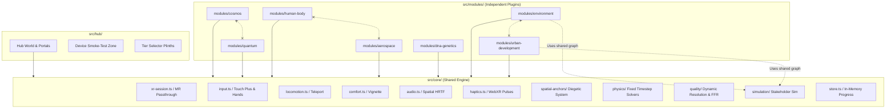

# MAARIFY — Architecture
_Last updated: 2026-11-08. Owner: architect & immersion-reviewer._
_Target Hardware: Meta Quest 3 (Primary), Quest 3S, Quest 2 (Baseline)_

## 1. Architectural Philosophy: Immersion-First WebXR
Maarify is engineered from the ground up as a native 6DOF Virtual Reality experience running within the Meta Quest Browser. The architecture strictly implements the **MAARIFY IMMERSION CHARTER** (`docs/IMMERSION_CHARTER.md`):
- **Spatial Anchors over 2D UI:** 2D floating screens, head-locked HUDs, and scrollable panels are strictly eliminated.
- **Physical Demonstrations over Text Paragraphs:** Level 2 technical knowledge is rendered as an interactive, scrubbable 3D micro-simulation at the object's spatial coordinates.
- **Strict Decoupling:** Modules are independent plugins that never import each other. Core provides shared spatial primitives and physics abstractions without module-specific code.

---

## 2. Directory Structure
```
c:\maarify\
  src/
    core/
      xr/               # XR session lifecycle, IWER emulator harness, hit-test, MR passthrough
      input/            # Touch Plus controllers & optical hand tracking (joints/pinches), direct poke
      locomotion/       # Teleportation arc, snap-turn, smooth locomotion + vignette
      comfort/          # Dynamic radial FOV restrictor, seated mode offset
      audio/            # Web Audio API positional 3D audio (HRTF attenuation)
      haptics/          # WebXR gamepad haptic actuators (pulses, detents, stall buffeting)
      spatial-anchors/  # Diegetic 3D anchor tags, leader lines, micro-sim controller
      physics/          # Fixed-timestep accumulator (120 Hz) + kinematic solvers
      quality/          # Dynamic quality controller (framebufferScale, fixedFoveation, target FPS)
      simulation/       # Shared stakeholder-sim library (Environment + Urban Dev)
      store/            # In-memory progress store behind SwappableStorage interface
      types.ts          # ModuleDefinition, SpatialAnchor, ChallengeDefinition
    hub/                # Spatial portal hub, scale model selector, device smoke-test zone
    modules/
      cosmos/           # Vertical slice
      quantum/
      human-body/
      aerospace/        # Fluid dynamics & rocket engine cycles
      dna-genetics/
      environment/
      urban-development/
    gamification/       # Physical badge plinths, 3D XP particle visualizer
  tests/
    unit/               # Vitest unit tests (store, fixed timestep determinism, math)
    e2e/                # Playwright + IWER headless Quest emulator playthroughs + multi-pose camera captures
  scripts/              # Cross-platform Node.js automation scripts (registered in SCRIPTS.md)
  docs/                 # Single source of truth specifications, build status, and architectural logs
```

---

## 3. Hardware Quality Tiers & Dynamic Quality Controller

### 3.1 Two Hardware Tiers
- **Tier A (Quest 2 Baseline):**
  - Display Refresh: 72 Hz
  - Triangles: $< 100,000$ per scene
  - Draw Calls: $< 100$ per scene
  - Textures: KTX2 Basis Universal only
  - Shadows: Baked contact shadows / ambient occlusion only
- **Tier B (Quest 3 / 3S Provisional):**
  - Display Refresh: 90 Hz / 120 Hz
  - Triangles: $< 250,000$ per scene (provisional, NOT measured on device)
  - Draw Calls: $< 180$ per scene (provisional, NOT measured on device)
  - Textures: High-resolution KTX2
  - Lighting: Lightweight directional key light + procedural specular highlights
  - Mixed Reality: Full-color passthrough tabletop mode (`immersive-ar` + `alpha-blend`)

### 3.2 Dynamic Quality Controller (`src/core/quality/`)
Rather than brittle device-name hardcoding, quality adapts at runtime using standard WebXR APIs:
- **Refresh Rate:** Checks `session.supportedFrameRates` and requests highest target (`session.updateTargetFrameRate(90)` or `72`).
- **Framebuffer Scale:** Scales `XRWebGLLayer.framebufferScaleFactor` between `0.7` and `1.2`.
- **Fixed Foveation:** Adjusts `baseLayer.fixedFoveation` dynamically between `0.0` (sharp periphery) and `1.0` (maximum foveation) based on a rolling 60-frame moving average of frame render time.

---

## 4. Fixed-Timestep Physics & Simulation (`src/core/physics/`)
To guarantee identical physical behaviour and educational determinism across 72 Hz, 90 Hz, and 120 Hz displays:
- **Accumulator Engine:** Simulation runs on a fixed internal clock ($dt = 1/120\text{ s} \approx 8.33\text{ ms}$).
- **State Interpolation:** Visual mesh transforms interpolate between previous and current physics states ($\alpha = \text{remainder} / dt$), eliminating jitter.
- **Unit Tested:** Mathematical determinism validated via Vitest tests comparing multi-rate simulation outputs.

---

## 5. Core Subsystems

### 5.1 Spatial Anchor & Micro-Simulation System (`src/core/spatial-anchors/`)
Replaces the flat "info card" with an anchored 3D label and an interactive micro-simulation:
- **Resting Affordance:** Mesh surfaces feature a subtle Fresnel glow or specular pulse shader on interactive components.
- **Level 1 — Spatial Anchor Tag:** When hovered or tapped, an animated spatial leader line (`THREE.Line2`) extends from the part to a compact 3D pill hovering 0.15–0.25 m away. Displays part name and $\le 40$-word plain language note.
- **Level 2 — Exploded Micro-Simulation:** Second tap expands the component into an exploded view, animated cross-section, or physical mechanism (e.g., heart valve pressure pump, Bloch vector sphere, rocket engine turbopump assembly).
- **Level 3 — Dismissal:** Contraction animation back into resting assembly.

### 5.2 Direct Manipulation Input & Touch Plus Haptics (`src/core/input/`, `src/core/haptics/`)
- Supports **Direct Touching** (index finger joint collision within 0.15 m) and **Distance Ray Grabbing** (curved bezier ray with magnetic snap).
- **Haptic Detents (`src/core/haptics/`):** Fires distinct pulses on Touch Plus controllers (`gamepad.hapticActuators[0].pulse(intensity, duration)`).
- **Graceful Desktop Degradation:** Mouse click maps to pinch/grab; mouse look maps to head rotation; WASD maps to teleport target translation. Never compromises VR-first ergonomics.

### 5.3 Audio Architecture (`src/core/audio/`)
- Built on `THREE.AudioListener` and `THREE.PositionalAudio`.
- Emits HRTF spatialized sound from interacting 3D components.
- Ambient mentor voice ("Dr. Amani") positioned in world space as an ambient spatial beacon.

### 5.4 Shared Stakeholder Simulation (`src/core/simulation/`)
- A shared causal graph engine shared between **Environment** and **Urban Development**.
- Models interconnected agent nodes with feedback loops, non-linear thresholds, and resource state updates.

---

## 6. Dependency Graph



---

## 7. Performance Budget Enforcement
Automated verification via `scripts/check-budgets.mjs`:
- Verified against Tier A (Quest 2 baseline: $< 100\text{k}$ tris, $< 100$ draw calls, 72 fps target) and Tier B (Quest 3 provisional).
- Realtime shadow maps strictly forbidden unless approved in writing.
